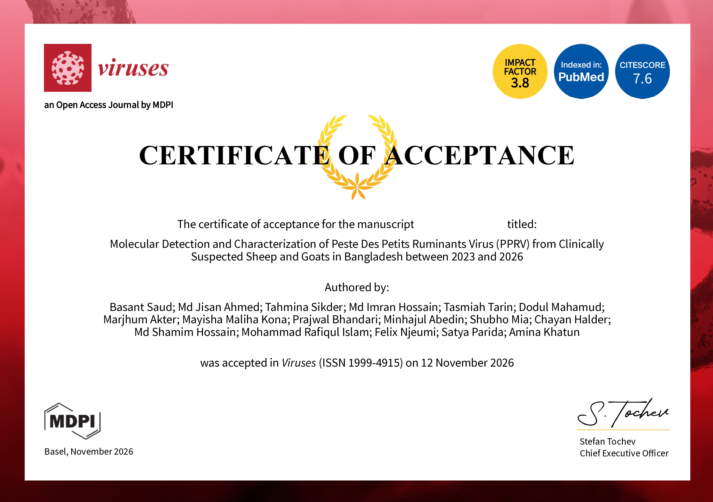

**Exciting news for AK lab!!**

Our research article entitled "Molecular Detection and Characterization of Peste des Petits Ruminants Virus (PPRV) from Clinically Suspected Sheep and Goats in Bangladesh between 2023 and 2026" has been accepted for publication in MDPI [Viruses](https://www.mdpi.com/journal/viruses). 

